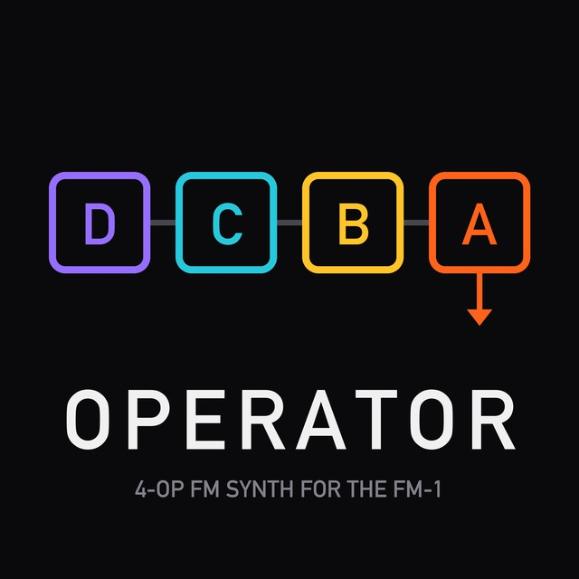
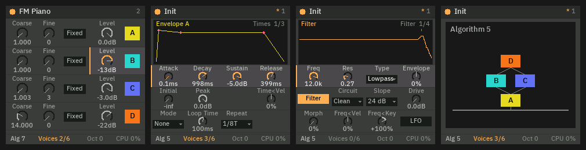

<p align="center">
  
</p>

<h1 align="center">OPERATOR</h1>

<p align="center">
  An FM synth firmware for the M-VAVE FM-1, inspired by Ableton Live's Operator<br>
  <a href="https://npi3pak.github.io/fm1-operator/"><b>Web installer</b></a> ·
  <a href="docs/MANUAL.md">Manual</a> ·
  <a href="https://github.com/npi3pak/fm1-operator/releases">Releases</a> ·
  <a href="BUILDING.md">Building</a>
</p>

<p align="center">
  <a href="https://github.com/npi3pak/fm1-operator/releases/latest"></a>
  <a href="LICENSE"></a>
</p>

OPERATOR turns the M-VAVE FM-1 into a polyphonic FM synth, inspired by Ableton Live's Operator and built to carry
its presets over: the same four oscillators, algorithms, envelopes, LFO, pitch envelope, filter and shaper, with the
same options. It is an independent project, not affiliated with or endorsed by Ableton.

> [!NOTE]
> Early days: the engine and the pages are in place but not yet heard on the hardware, the algorithm routings are
> provisional, and the depths of several modulations still have to be matched to the original by ear.

- 4 oscillators (A–D), 23 waveforms (sine, saws, squares, triangle, noise) and user partials, fixed frequency,
  feedback, phase; 11 algorithms
- 7 envelopes (4 oscillators, filter, pitch, LFO) with Loop, Beat, Sync and Trigger modes, the global Time
- LFO up to audio rate, pitch envelope, filter (LP, HP, BP, notch, morph; 12 / 24 dB) and waveshaper
- up to 6 voices (presets keep Operator's 1–32), Spread (a stereo voice pair), glide, MIDI routing for velocity,
  key, aftertouch, pitch bend and the mod wheel
- a read-only preset bank in the firmware and user slots in flash; USB-MIDI and TRS MIDI in; 48 kHz audio



> [!WARNING]
> **Installing custom firmware is at your own risk.** OPERATOR is unofficial firmware, provided as is, without any
> warranty (GPL-3.0 sections 15 and 16). It is not made, endorsed or supported by M-VAVE. A failed or interrupted
> install can leave the FM-1 unable to start until it is recovered with a USB tool. You can return to the official
> firmware at any time.

## Install

1. Charge the FM-1 and plug it straight into the computer with a data cable. Close apps that use MIDI.
2. Open the **[web installer](https://npi3pak.github.io/fm1-operator/)** in Chrome or Edge (Safari and Firefox have no
   Web MIDI with SysEx).
3. Press **Install**. Leave the cable alone until it says Done.

From the command line, with a package from [Releases](https://github.com/npi3pak/fm1-operator/releases):

```bash
pip install mido python-rtmidi
python3 tools/fm1_install.py operator-0.1.fwsc
```

**Back to the official firmware:** download FM-1 V15 from [m-vave.com/download](https://www.m-vave.com/download) and
write it with the web installer's "Back to the official firmware". OPERATOR uses the Felucca platform's update loader,
so other Felucca-platform firmware (SLOOP, ORBIT, ChoralRoot, AMB-1) installs over it the usual way.

**If something goes wrong:** an interrupted write resumes when you press Install again. After two failed boots in a
row the FM-1 opens USB RESCUE by itself (or hold OCT− at power-on), and the installer works there too. An FM-1 that
does not start at all can be recovered with [MvaveFM1Unbricker](https://github.com/Quixotic7/MvaveFM1Unbricker).

## Use

See the **[manual](docs/MANUAL.md)**: the pages, the buttons and MIDI.

## Build

See **[BUILDING.md](BUILDING.md)**: the toolchain, `./build.sh`, the host simulator and tests, and how a release is
made. [docs/DEVELOPING.md](docs/DEVELOPING.md) describes the platform and its app API, for writing your own FM-1
firmware on it.

## Credits

OPERATOR is made by [npi3pak](https://github.com/npi3pak). It stands on the work of:

- **Leo Kuroshita, Hügelton Instruments**: [Felucca](https://github.com/hugelton/Felucca), the FM-1 platform: HAL,
  update loader, USB-MIDI, OTA, storage and installers (GPL-3.0).
- **dspaudio**: [ORBIT](https://github.com/dspaudio/orbit), the platform OPERATOR was cut down from.
- **isod89**: [SLOOP](https://github.com/isod89/sloop-fm1), the web install protocol and the stock supply levels.
- **Quixotic7**: [ChoralRoot](https://github.com/Quixotic7/ChoralRootFM1), the audio interrupt fix and the release
  layout; [MvaveFM1Unbricker](https://github.com/Quixotic7/MvaveFM1Unbricker).
- **Charles Vestal**: [AMB-1](https://github.com/charlesvestal/fm1-amb), which showed the FPU in use on the FM-1.
- **Dimitar Toshkov Zhekov**: the Terminus font (SIL OFL 1.1).
- **IBM**: the IBM Plex Sans font (SIL OFL 1.1).
- **Ableton**: the preset bank is Operator's factory presets from Ableton Live 12's Core Library, converted to
  OPERATOR's parameters (`presets/ableton/`). Ableton and Operator are Ableton AG's; OPERATOR is not affiliated with
  or endorsed by Ableton.
- **JieLi Technology**: three AC79 SDK files in every package (Apache-2.0).

## License

OPERATOR is free software under the [GNU General Public License v3.0 only](LICENSE), provided without any warranty.
The parts it is built from keep their licences and copyright notices:

| Part | Author | Licence | Text |
|---|---|---|---|
| OPERATOR (the app, web installer, release tooling, logo) | npi3pak | GPL-3.0-only | [LICENSE](LICENSE) |
| Felucca platform: HAL, update loader, USB-MIDI, OTA, storage, tools (through ORBIT and SLOOP, modified) | Leo Kuroshita, Hügelton Instruments | GPL-3.0-only | [LICENSE](LICENSE) |
| Web install protocol `fm1ota.js`, `fm1pkg.js` (from SLOOP 2.7, unchanged) | Leo Kuroshita, Hügelton Instruments; isod89 | GPL-3.0-only | [LICENSE](LICENSE) |
| Terminus font (rasterised into the firmware) | Dimitar Toshkov Zhekov | SIL OFL 1.1 | [LICENSES/OFL-Terminus.txt](LICENSES/OFL-Terminus.txt) |
| IBM Plex Sans font (rasterised into the firmware) | IBM Corp. | SIL OFL 1.1 | [LICENSES/OFL-IBM-Plex-Sans.txt](LICENSES/OFL-IBM-Plex-Sans.txt) |
| Three AC79 SDK files in every package (`tools/sdk`, unmodified) | JieLi Technology | Apache-2.0 | [LICENSES/Apache-2.0-JieLi-SDK.txt](LICENSES/Apache-2.0-JieLi-SDK.txt) |

Every release and the web installer carry these licence texts next to the packages, and each release's complete
source is its tag in this repository. [LICENSING.md](LICENSING.md) has the details.

"M-VAVE" and "FM-1" are trademarks of their respective owners; "Ableton", "Live" and "Operator" are trademarks of
Ableton AG. OPERATOR is not affiliated with, endorsed by or supported by them.
